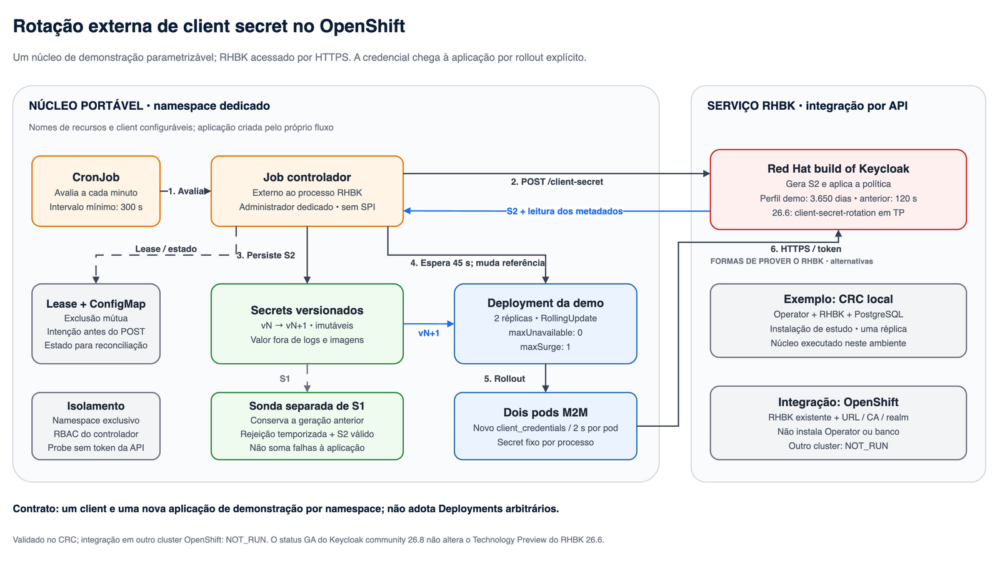

# Rotação externa de client secrets no OpenShift

Base de demonstração para **Red Hat build of Keycloak**, com aplicação M2M contínua, Secrets imutáveis versionados e rollout controlado. A automação externa decide quando trocar; o RHBK gera a nova credencial; o OpenShift distribui e atualiza os consumidores. O `client_id` permanece igual. Não há SPI.



## O que foi validado

No CRC ARM64, com **RHBK 26.6.9.redhat-00002**, validamos dois perfis na instalação anterior à migração para imagem otimizada e OLM:

| Perfil | Principal | Anterior após POST | Decisão externa |
|---|---:|---:|---|
| Demonstração atual | 315360000 s — 3650 dias | 120 s | Intervalo mínimo de 300 s; avaliação a cada minuto |
| Ensaios de expiração | 300 s | 120 s | Prazos curtos para observar vencimentos reais |

O POST reiniciou a validade da nova secret. A antiga, que antes venceria em 2036, passou a vencer 120 segundos após a troca. A aplicação autenticou com a nova credencial depois da rejeição da antiga. Nos dois ciclos acompanhados em 10/11/2026, o intervalo observado entre POSTs foi **359,705 s, aproximadamente 6 minutos**. Não é um agendamento de 5 minutos exatos. Veja os [resultados e limites](docs/resultados.md).

Os 3650 dias são um prazo finito de demonstração, não uma recomendação universal de segurança. A periodicidade externa pode ser muito menor; suspender a automação não renova nem elimina o vencimento da secret atual.

Em 10/11/2026, o build otimizado, a migração do Operator para OLM e o deploy com `start --optimized` foram executados nesse CRC. A substituição da única réplica RHBK causou **24 falhas de autenticação** nos dois pods M2M; depois, o baseline voltou a passar. Isso não foi uma migração sem interrupção. A rotação posterior **v0032 → v0033 passou**, com rejeição da antiga e autenticação da nova; veja [resultados](docs/resultados.md).

## Instalar e usar

A instalação do RHBK é **a mesma no CRC e nos demais ambientes OpenShift**: Operator pelo OLM, imagem otimizada pelo BuildConfig e servidor declarado por um `Keycloak` CR. Os valores de namespace, arquitetura, hostname, banco, imagens e recursos ficam em um arquivo de parâmetros.

| Necessidade | Guia |
|---|---|
| Instalar RHBK, inclusive em um CRC novo | [Instalação comum OpenShift](docs/imagem-rhbk.md) |
| Instalar a demonstração conectada a esse RHBK ou a um servidor existente | [Aplicação e automação de rotação](docs/openshift.md) |
| Operar o laboratório CRC que já está instalado | [Operação e manutenção CRC](docs/operacao.md) |

Para começar uma instalação nova, escolha **um** exemplo e preencha os dados reais do ambiente:

```sh
umask 077
mkdir -p .private
cp config/rhbk-install.openshift.env .private/rhbk-install.env
# Para CRC, copie config/rhbk-install.crc.env no lugar do exemplo acima.
make rhbk-render PARAMS=.private/rhbk-install.env
```

A renderização é local: produz os manifests para revisão e não altera o cluster. Continue pelo [guia comum](docs/imagem-rhbk.md), que contém os comandos de instalação, build e verificação. Os exemplos não contêm senhas nem selecionam automaticamente uma nova versão do produto.

O [Dockerfile](apps/rhbk/Dockerfile) e os [templates de instalação](deploy/install/) são os artefatos comuns. O PostgreSQL de demonstração é opcional; a instalação também aceita um banco já fornecido pelo ambiente. Os scripts antigos `setup.py`, `rhbk_image.py`, `operator_olm.py` e `lab.py deploy` ficam para manutenção da instalação CRC anterior, sem participar do novo procedimento.

O contrato da demonstração continua sendo **uma aplicação M2M e um client por namespace**. O namespace da demonstração pode ser diferente do namespace RHBK. Adaptar a distribuição a uma aplicação existente exige que ela carregue a nova credencial no rollout; esta base não altera Deployments arbitrários.

O procedimento comum passou por 294 testes locais e validação de 12 recursos por `dry-run` na API do CRC, sem alterar o laboratório. Sua instalação integral em um cluster novo permanece **não executada**; os resultados históricos registrados correspondem ao CRC já instalado, não a uma homologação de todos os ambientes OpenShift.

## Usar a demonstração já instalada no CRC

```sh
make preflight
make watch               # tabela legível; grava observações JSONL em evidence/
make automation-start    # altera estado: habilita a decisão periódica
make collect             # coleta local, sem rotacionar
```

No caminho OpenShift, use os comandos correspondentes `make openshift-watch`, `make openshift-baseline`, `make openshift-start`, `make openshift-stop` e `make openshift-collect`, após concluir seu [guia de configuração](docs/openshift.md).

Para acompanhar diretamente as autenticações com a **secret antiga e a nova**, use o [observador de convivência](docs/teste-convivencia.md). Ele acompanha a automação existente e não solicita uma rotação.

O [roteiro de apresentação](docs/apresentacao.md) traz os comandos e o que explicar ao cliente. A tabela mostra os dois pods principais; as rejeições das sondas antigas não são somadas às falhas da aplicação. Ctrl+C para apenas a observação.

```sh
make automation-stop     # suspende novas rotações; um Job iniciado precisa terminar
make collect
```

## Configuração e verificações

- [Arquitetura e limites de portabilidade](docs/arquitetura.md).
- [Perfil longo](realm/profile.json): principal de 3650 dias, convivência de 120 s e janela de antecipação dinâmica igual a zero.
- [Perfil curto](realm/profile-short.json): ensaios de expiração principal, separados da apresentação.
- [Parâmetros de instalação RHBK](config/rhbk-install.openshift.env) e [exemplo CRC](config/rhbk-install.crc.env): mesmo procedimento, valores diferentes.
- [Configuração da demonstração](config/openshift.example.json): URL/CA, realm, client e imagens, sem credenciais em texto.
- [Versões do exemplo CRC](versions.lock.yaml): verificadas em 09/11/2026, não são a seleção automática da versão mais recente.

```sh
make test                 # testes locais, sem cluster
make watch-json           # saída técnica; útil para integrações e análise
```

`make test-post-expiration` é um ensaio **CRC** que altera clients descartáveis e exige o perfil curto; o teste recusa o perfil longo para não aguardar anos. `make test-periodic` também é do CRC e correlaciona Jobs do Cron com pelo menos três ciclos. Não execute esses ensaios durante uma apresentação ou contra uma instalação OpenShift genérica.

Em RHBK 26.6, `client-secret-rotation` permanece [Technology Preview](https://docs.redhat.com/en/documentation/red_hat_build_of_keycloak/26.6/html/server_administration_guide/assembly-managing-clients_server_administration_guide). No [Keycloak comunitário 26.8](https://www.keycloak.org/2026/10/keycloak-2680-released), foi promovido a supported; isso não transfere suporte ao produto Red Hat. Os resultados deste laboratório não homologam produção, HA ou outras versões.

Arquivos privados, kubeconfigs e evidências brutas ficam em `.private/` e `evidence/`, ignorados pelo Git. O repositório contém código, configurações de exemplo, diagramas e sínteses dos resultados. Atualizar o checkout não altera imagens nem recursos em execução.
