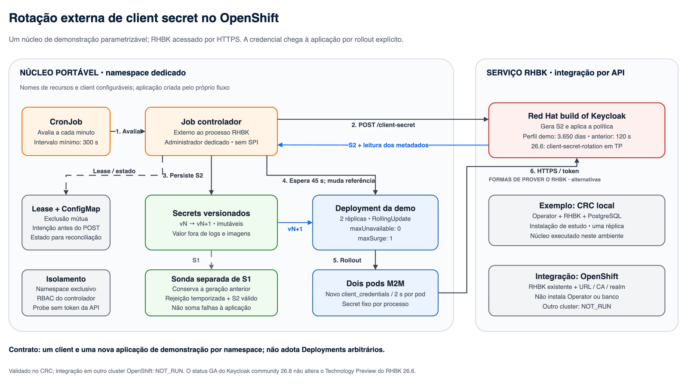
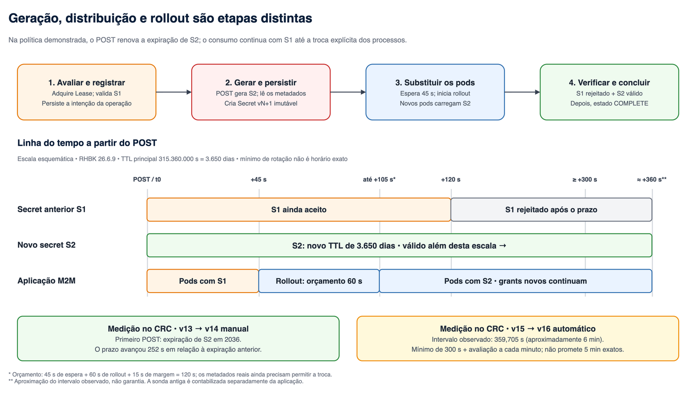

# Arquitetura da rotação externa

O núcleo combina um controlador periódico, Secrets Kubernetes imutáveis e uma aplicação M2M de demonstração. A decisão de rotacionar ocorre fora do processo RHBK, por Admin REST API; não há SPI, alteração no código do servidor ou atualização automática da credencial dentro de um processo já iniciado.

## Responsabilidades e limites

| Componente | Responsabilidade |
|---|---|
| CronJob e Job controlador | Avaliar elegibilidade, adquirir Lease, persistir intenção, solicitar a rotação, distribuir S2 e conduzir o rollout. |
| RHBK | Gerar o secret, aplicar a política de expiração e validar cada autenticação. O POST usa `/admin/realms/{realm}/clients/{uuid}/client-secret`; o UUID é resolvido pelo client ID. |
| Lease e ConfigMap | Coordenar exclusão mútua e estado durável. Uma resposta perdida não autoriza repetir o POST; a reconciliação precisa comprovar a linhagem. |
| Secret versionado | Guardar a credencial de uma geração sem sobrescrever a anterior. O PodTemplate referencia explicitamente a nova versão. |
| Deployment da demonstração | Manter duas réplicas, com `maxUnavailable: 0` e `maxSurge: 1`. O fluxo cria essa aplicação; não adota um Deployment arbitrário. |
| Pods M2M | Ler o secret uma vez ao iniciar e fazer um novo `client_credentials` a cada dois segundos por pod, sem cache de token ou fallback para outra credencial. |
| Sonda antiga | Conservar S1 e medir sua rejeição, com S2 como controle positivo. Seus erros esperados ficam separados dos da aplicação principal. |

O controlador tem identidade administrativa RHBK própria e ServiceAccount Kubernetes. A sonda não recebe token Kubernetes nem acesso à Admin API. A capacidade do controlador de ler Secrets e criar pods torna **o namespace inteiro** sua fronteira de confiança; não coloque credenciais de outros projetos nele.

## Duas formas de fornecer a infraestrutura

**Exemplo CRC.** A preparação local instala Operator, RHBK e PostgreSQL, com PVC e uma réplica do servidor. Imagens, registry, DNS e kubeconfig desse exemplo são detalhes de instalação, separados da lógica de rotação.

**Integração OpenShift.** A base usa um RHBK existente, configurado por URL, CA, realm e identidade administrativa autorizada. Cria uma nova aplicação de demonstração e seus recursos em um namespace dedicado; não instala Operator, banco ou infraestrutura de nuvem. O RHBK deve ter a feature e a política compatíveis habilitadas. Registry, arquitetura das imagens, permissões, conectividade TLS e capacidade precisam ser verificados no ambiente escolhido.

O comportamento de rotação foi executado no CRC. A execução da integração em **outro cluster OpenShift é `NOT_RUN`**. Parametrização e testes locais não comprovam compatibilidade universal nem homologação em produção.

## Contrato de configuração

| Parâmetro | Escopo |
|---|---|
| `NAMESPACE` | Namespace exclusivo dos recursos da demonstração. |
| `TARGET_CLIENT_ID` | Client confidencial que terá a credencial rotacionada. |
| `SECRET_PREFIX` | Prefixo dos Secrets imutáveis de cada geração. |
| `CRONJOB_NAME`, `DEPLOYMENT_NAME` | Agendamento e Deployment criados para essa demonstração. |
| `STATE_NAME`, `LEASE_NAME` | ConfigMap de estado e Lease da mesma operação. |
| `RHBK_URL`, `RHBK_CA_FILE`, `REALM` | Endpoint e confiança TLS do RHBK. |
| `ADMIN_CLIENT_ID`, `ADMIN_CLIENT_SECRET_FILE` | Identidade administrativa separada; o valor da credencial vem de arquivo montado, não de argumentos ou logs. |

Esses nomes precisam permanecer coerentes entre configuração, manifests e RBAC. Cada namespace atende um par client/aplicação de demonstração. A parametrização do nome do Deployment não amplia o contrato para aplicações existentes: o controlador verifica o formato da sonda, a geração e autenticações recentes em `/status`.

## Sequência e tempos

1. O Job adquire a Lease, verifica o estado e a autenticação de S1, e persiste a intenção antes do POST.
2. O RHBK gera S2. O controlador lê os metadados, valida S2 e cria o Secret imutável da nova geração.
3. Após a espera configurada, altera a referência do PodTemplate. Cada novo processo inicia com S2; os processos antigos continuam com S1 até serem substituídos.
4. A conclusão exige a nova geração autenticando e a rejeição temporizada de S1, com controles positivos. Só então o estado passa a `COMPLETE`.

| Parâmetro da demonstração | Valor |
|---|---:|
| TTL principal | 315.360.000 s = 3.650 dias, aproximadamente dez anos |
| TTL da credencial anterior | 120 s |
| Intervalo mínimo entre rotações | 300 s |
| Avaliação do CronJob | A cada minuto |
| Espera antes do rollout | 45 s |
| Orçamento de rollout / margem | 60 s / 15 s |

Os desenhos representam esse perfil longo de demonstração. O [perfil curto](../realm/profile-short.json), com principal de 300 s, anterior de 120 s e janela de atualização de 60 s, serve aos ensaios CRC que aguardam vencimentos reais. Ele não é o perfil longo apresentado acima; os ensaios temporizados precisam conferir a política efetiva antes de criar seus clients.

O TTL longo é um parâmetro didático; não é uma recomendação de política de segurança. A espera, o orçamento e a margem somam 120 segundos, mas o controlador ainda precisa conferir a janela efetiva nos metadados do servidor. Atrasos, indisponibilidade de capacidade e pausas do host podem impedir a troca segura.

O mínimo de 300 segundos torna a rotação elegível; a execução depende da próxima avaliação e do agendamento. Na demonstração, o intervalo automático **v15 → v16 foi 359,705 segundos**, aproximadamente seis minutos. Não há promessa de uma rotação exatamente a cada cinco minutos.

No primeiro POST manual **v13 → v14**, a expiração informada para S2 permaneceu em 2036 e avançou **252 segundos** em relação ao prazo anterior. Isso demonstra renovação do timestamp nesse ensaio. Não significa que a validade foi acompanhada até 2036. Os resultados e seu alcance estão em [resultados](resultados.md).

## Observação, recuperação e suporte

`Running`, readiness e autenticação atual são sinais diferentes. A sonda só fica Ready após seu primeiro sucesso; depois disso, rejeições de credencial aparecem nas métricas sem reiniciar o processo ou retirar o pod do Service. Acompanhamento deve combinar geração, último HTTP, timestamp e contadores; dado ausente não significa sucesso. Contagens amostradas por pod são limites inferiores, pois requisições após a última amostra e antes da exclusão podem não ser capturadas.

RHBK e Kubernetes não participam de uma transação única. `reconcile` retoma uma intenção conhecida; resultado ambíguo permanece bloqueado. Recuperação de um principal já vencido é uma intervenção explícita, com indisponibilidade prévia registrada, e não um ciclo normal com continuidade. Consulte [operação e recuperação](operacao.md).

No **RHBK 26.6**, `client-secret-rotation` permanece Technology Preview. A documentação do **Keycloak community 26.8** promove a feature a suportada, mas esse status não altera o suporte do produto RHBK nem demonstra que este código foi validado nessa versão community. Fontes: [RHBK 26.6 — preview features](https://docs.redhat.com/en/documentation/red_hat_build_of_keycloak/26.6/html-single/server_configuration_guide/index) e [Keycloak 26.8 — release notes](https://www.keycloak.org/docs/26.8.0/release_notes/).

Os desenhos editáveis estão em [arquitetura-rotacao-externa.drawio](diagramas/arquitetura-rotacao-externa.drawio), com duas páginas. Os PNGs são exports do mesmo arquivo; nenhum deles representa saúde em tempo real.
